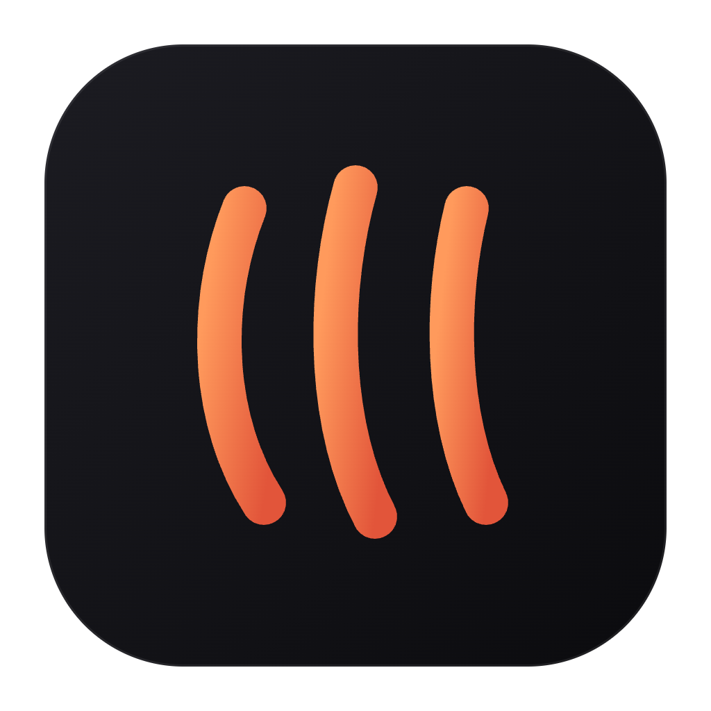
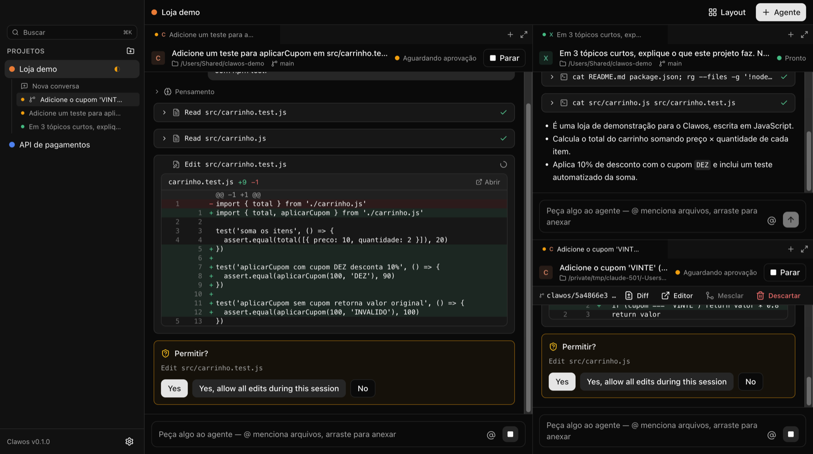
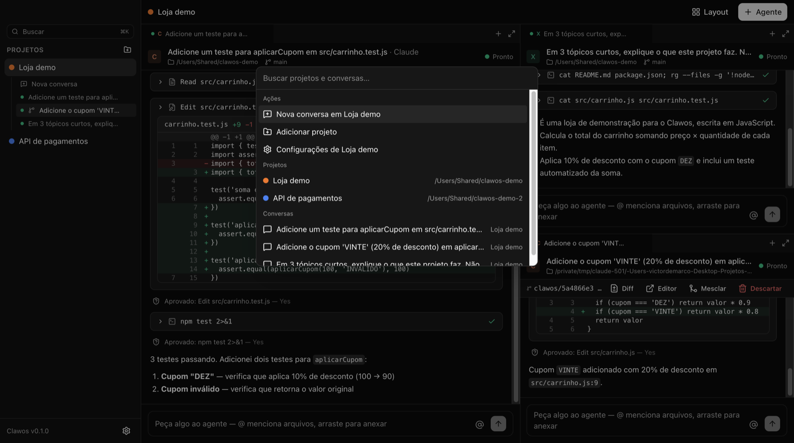
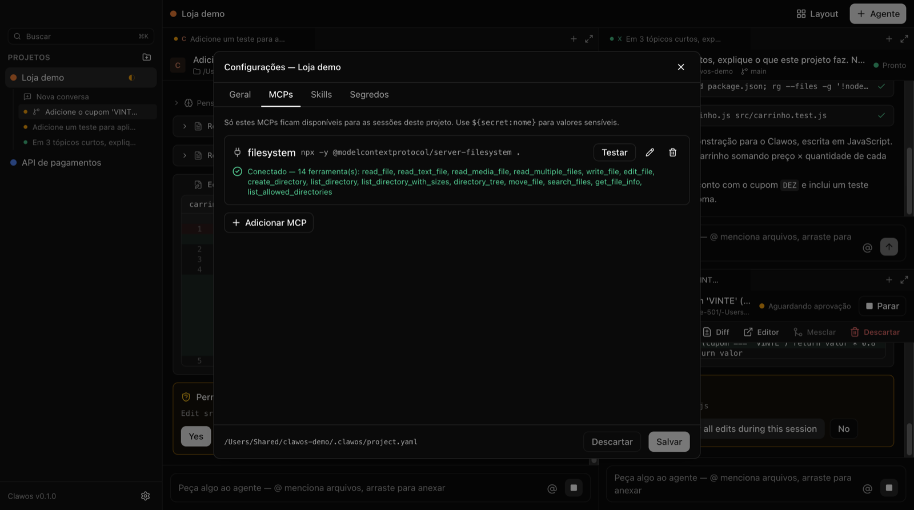
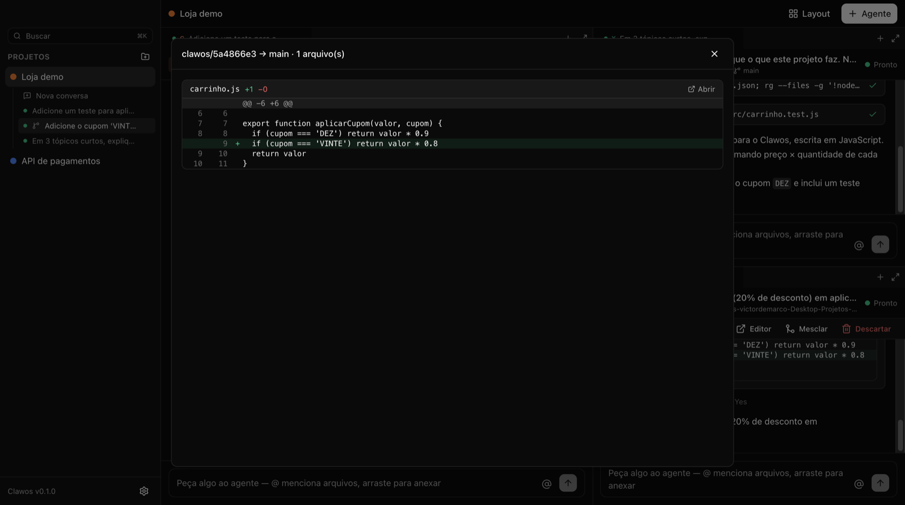

<p align="center">
  
</p>

<h1 align="center">Clawos</h1>

<p align="center">
  Vários agentes de código, vários projetos, um chat limpo.<br />
  Claude, Codex e outros agentes compatíveis com ACP lado a lado — 100% local, com a sua própria conta.
</p>

<p align="center">
  <a href="https://github.com/vdloureiro/clawos-ADE/releases">Download</a> ·
  <a href="#primeiros-5-minutos">Primeiros passos</a> ·
  <a href="CONTRIBUTING.md">Contribuir</a>
</p>



## O que é

O Clawos é um app desktop open source (MIT) para trabalhar com agentes de código de IA como num chat, não num terminal:

- **Vários agentes em paralelo**, em painéis que você arrasta, divide e agrupa em abas, com layouts salvos por projeto.
- **Chat estruturado**: respostas em markdown, ações do agente como cards ("Leu `src/app.ts`", "Rodou `npm test`"), diffs inline e pedidos de permissão com Aprovar/Recusar.
- **Projetos isolados**: cada projeto tem seus próprios MCPs, skills e instruções. Nada vaza de um projeto para outro — nem os MCPs globais da sua máquina.
- **Worktrees isoladas**: dois agentes podem mexer no mesmo arquivo, cada um na sua branch, e você mescla pela interface.
- **Troca de projeto em um clique**, com indicadores de quem está trabalhando (●), esperando aprovação (◐) ou com erro (!), e notificações do sistema.

Princípios: **100% local** (sem servidor, conta ou telemetria), **o Clawos nunca toca nas suas credenciais** (você entra nos CLIs oficiais com a sua assinatura) e conversa com os agentes pelo [Agent Client Protocol](https://agentclientprotocol.com).

## Instalação

Baixe o instalador da sua plataforma na página de [Releases](https://github.com/vdloureiro/clawos-ADE/releases):

| Sistema               | Arquivo                                   |
| --------------------- | ----------------------------------------- |
| macOS (Apple Silicon) | `Clawos-x.y.z-mac-arm64.dmg`              |
| macOS (Intel)         | `Clawos-x.y.z-mac-x64.dmg`                |
| Windows               | `Clawos-x.y.z-windows-setup.exe`          |
| Linux                 | `Clawos-x.y.z-linux-*.AppImage` ou `.deb` |

**macOS — recomendado:** instale pelo Terminal. O comando baixa a versão certa para o seu Mac, instala em Aplicativos e abre o app, sem o aviso de verificação do macOS:

```bash
curl -fsSL https://clawos.vercel.app/install.sh | bash
```

Os instaladores ainda não são notarizados pela Apple nem assinados pela Microsoft ([como ativar a notarização](docs/release-macos.md)):

- **macOS, pelo .dmg:** arraste o Clawos para Aplicativos e abra. Quando o macOS disser que _não pôde verificar se o Clawos está livre de malware_, vá em **Ajustes do Sistema → Privacidade e Segurança**, clique em **Abrir Mesmo Assim** e confirme com a sua senha. Alternativa: `xattr -dr com.apple.quarantine /Applications/Clawos.app`.
- **Windows:** se o SmartScreen avisar, clique em **Mais informações** → **Executar assim mesmo**.
- **Linux (AppImage):** `chmod +x Clawos-*.AppImage` e execute.

## Primeiros 5 minutos

1. **Instale o Claude Code** (o CLI oficial), se ainda não tiver:
   ```bash
   curl -fsSL https://claude.ai/install.sh | bash
   ```
2. **Abra o Clawos.** A tela inicial mostra se o Claude está instalado e logado. Se não estiver logado, clique em **Entrar**: o Clawos abre um terminal com o login oficial (`claude auth login`) — você entra no navegador com a sua conta e pronto. Quem já usa o Claude Code no terminal ou no VS Code não precisa entrar de novo.
3. **Adicione um projeto** (a pasta do seu código) e clique em **Nova conversa** — ou **+ Agente** no topo.
4. Peça algo, por exemplo: _"crie um arquivo hello.ts e rode-o"_. Você verá as ações do agente, o diff e os pedidos de permissão no chat.

### Outros agentes

| Agente | Instalação                                        | Login                                                                                                                                                                          |
| ------ | ------------------------------------------------- | ------------------------------------------------------------------------------------------------------------------------------------------------------------------------------ |
| Claude | `curl -fsSL https://claude.ai/install.sh \| bash` | `claude auth login` (botão **Entrar**)                                                                                                                                         |
| Codex  | `npm install -g @openai/codex`                    | `codex login` (botão **Entrar**); quem usa o app do Codex já está logado                                                                                                       |
| Gemini | `npm install -g @google/gemini-cli`               | API key do [AI Studio](https://aistudio.google.com/apikey) em `GEMINI_API_KEY` (ambiente ou `~/.gemini/.env`) — o login com conta Google pessoal foi descontinuado pelo Google |

> **Sobre contas claude.ai:** o Clawos usa o adaptador ACP oficial e o seu próprio CLI, com o login que você mesmo fez — ele nunca implementa um login próprio. A Anthropic não permite que produtos de terceiros _ofereçam_ login claude.ai sem aprovação prévia ([Agent SDK](https://code.claude.com/docs/en/agent-sdk/overview)); use conforme os termos da sua conta.

## Usando

### Painéis e layouts

Cada painel é uma conversa com um agente. Arraste abas para dividir a tela, use **Layout** para os presets (1 painel, 2 lado a lado, 1 grande + 2 laterais, grade 2×2) ou salve o seu. O layout de cada projeto é restaurado quando você volta a ele — e as sessões continuam rodando em segundo plano enquanto você está em outro projeto.

No chat, `@` menciona arquivos do projeto e você pode arrastar arquivos para anexar.



### Atalhos

| Atalho       | Ação                                           |
| ------------ | ---------------------------------------------- |
| `⌘K`         | Busca rápida de projetos e conversas           |
| `⌘T`         | Novo agente no projeto atual                   |
| `⌘W`         | Fechar o painel ativo (o histórico fica salvo) |
| `⌘.`         | Parar o agente do painel ativo                 |
| `⌘1`…`⌘9`    | Ir para o projeto 1…9                          |
| `⌘,` / `⌘⇧,` | Configurações / configurações do projeto       |
| `⌘⇧L`        | Alternar tema claro/escuro                     |

No Windows e no Linux, use `Ctrl` no lugar de `⌘`.

### Configuração por projeto

Cada projeto pode ter um `.clawos/project.yaml` — versionável no git do projeto e editável pela tela de configurações:

```yaml
name: Minha loja
defaultAgent: claude
instructions: ./CLAUDE.md # cada agente lê o seu nativo; outro arquivo é entregue a todos
skills:
  - ./.agents/skills/revisao-pr # pastas com SKILL.md
mcpServers:
  supabase:
    command: npx
    args: ['-y', '@supabase/mcp-server-supabase', '--read-only']
    env:
      SUPABASE_ACCESS_TOKEN: '${secret:supabase_token}'
agents:
  claude: { enabled: true }
  codex: { enabled: true }
```



- As sessões de um projeto enxergam **somente** os MCPs e as skills dele, em todos os agentes. No Codex, os MCPs globais, plugins e conectores do ChatGPT são desligados por sessão sem alterar a sua configuração.
- `${secret:nome}` vem dos **segredos do projeto**, guardados com a criptografia do sistema operacional. Nunca vão para o YAML nem para o git.
- Prefira `.agents/skills/` para skills: é lida por Claude, Codex e Gemini.
- `agents.claude.inheritUserConfig: true` também carrega a sua configuração global do Claude (`~/.claude`).

### Worktrees isoladas

Em **+ Agente**, escolha **Worktree isolada**: o agente trabalha numa branch própria (`clawos/<id>`), numa pasta fora do seu repositório, a partir do último commit da branch atual. No painel:

- **Diff** — o que mudou em relação à base;
- **Editor** — abre a worktree no VS Code/Cursor;
- **Mesclar** — commita as alterações e mescla na branch base (em caso de conflito, nada é alterado e os arquivos são listados);
- **Descartar** — apaga a worktree, a branch e a conversa.



Duas sessões na **mesma pasta** que editam o mesmo arquivo recebem um aviso.

## Desenvolvimento

Requisitos: Node.js 22.12+ (veja `.nvmrc`), pnpm 10 e git.

```bash
pnpm install
pnpm dev          # app em modo desenvolvimento
pnpm test         # testes (Vitest)
pnpm lint         # ESLint
pnpm typecheck    # TypeScript (main + renderer)
pnpm dist:mac     # instalador local (também dist:win, dist:linux)
```

Detalhes de arquitetura, como adicionar um agente e como publicar uma versão estão no [CONTRIBUTING.md](CONTRIBUTING.md). As decisões técnicas e o que foi verificado em cada agente estão em [docs/research.md](docs/research.md).

## Licença

[MIT](LICENSE)
